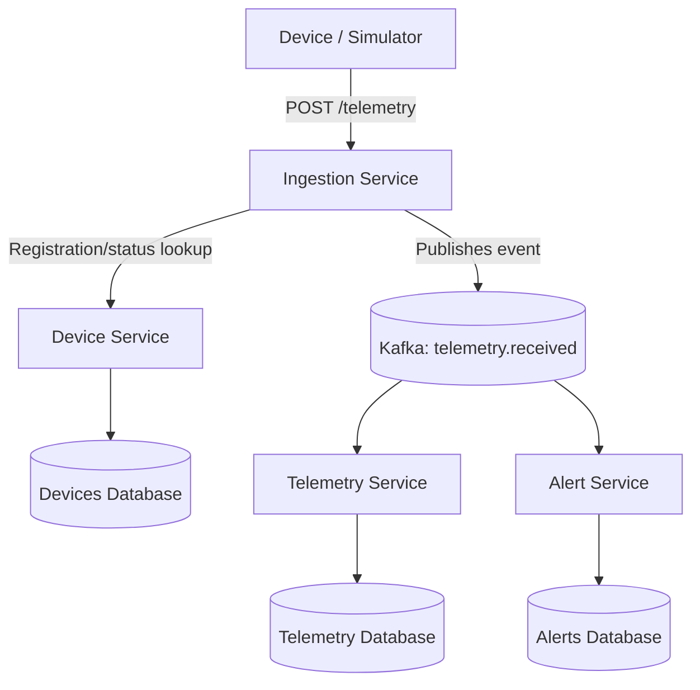

# IoT Monitor — Mid-Level Java Backend Challenge

A distributed system for ingesting, storing, and analyzing telemetry from industrial devices, with near-real-time alert generation.

> **Objective:** practice microservices with Spring Boot, Apache Kafka, and PostgreSQL, including idempotency, ordering, transient failures, data consistency, and integration testing.

## 1. Scope

The system receives temperature and energy consumption readings from registered devices. Readings are published to Kafka, persisted for historical queries, and analyzed for anomaly detection.

### Services

| Service | Responsibility | Communication |
| --- | --- | --- |
| `device-service` | Device registration, activation, and operating limits | REST |
| `ingestion-service` | Initial validation and publication of readings | REST → Kafka |
| `telemetry-service` | Reading consumption, persistence, and querying | Kafka → PostgreSQL; REST |
| `alert-service` | Alert detection, persistence, and resolution | Kafka → PostgreSQL; REST |

**Architectural rule:** each service is an independent Spring Boot application. No service may read another service's tables directly. To simplify the local environment, the services may share a PostgreSQL instance, but they must use separate databases.

### Main flow



## 2. Technology stack

- Java 25+
- Spring Boot (a stable version compatible with Java 25)
- Spring Web, Spring Validation, and Spring Data JPA
- Spring for Apache Kafka
- PostgreSQL
- Docker and Docker Compose
- Maven
- JUnit 5, Mockito, and Testcontainers
- Spring Boot Actuator (recommended)

## 3. Creating the projects with Spring Initializr

Go to [start.spring.io](https://start.spring.io/) and create **four independent Maven projects**.

Suggested initial configuration for all projects:

| Field | Value |
| --- | --- |
| Project | Maven |
| Language | Java |
| Java | 25 |
| Packaging | Jar |
| Group | `br.com.iotmonitor` |
| Artifact | Service name (`device-service`, etc.) |

Dependencies by service:

| Service | Initializr dependencies |
| --- | --- |
| Device | Spring Web, Validation, Spring Data JPA, PostgreSQL Driver, Actuator |
| Ingestion | Spring Web, Validation, Spring for Apache Kafka, Actuator |
| Telemetry | Spring Web, Validation, Spring Data JPA, PostgreSQL Driver, Spring for Apache Kafka, Actuator |
| Alert | Spring Web, Validation, Spring Data JPA, PostgreSQL Driver, Spring for Apache Kafka, Actuator |

Add **Testcontainers**, **JUnit**, and **Mockito** to each project as needed. Spring Boot Starter Test already provides the testing foundation for the projects.

### Suggested repository structure

```text
iot-monitor/
├── README.md
├── ARCHITECTURE.md
├── compose.yaml
├── .env.example
├── device-service/
│   ├── pom.xml
│   └── src/
├── ingestion-service/
│   ├── pom.xml
│   └── src/
├── telemetry-service/
│   ├── pom.xml
│   └── src/
├── alert-service/
│   ├── pom.xml
│   └── src/
└── scripts/
    └── simulator/   # Implementation is up to you
```

Using a Maven multi-module project is not required; initially, independent Maven projects make the isolation more explicit.

## 4. Minimum API contracts

### Device Service

- `POST /devices`: register a device.
- `GET /devices`: list devices.
- `GET /devices/{id}`: retrieve a device.
- `PUT /devices/{id}`: update metadata and limits.
- `PATCH /devices/{id}/status`: activate or deactivate a device.

Creation example:

```json
{
  "id": "device-001",
  "name": "Boiler A Sensor",
  "type": "TEMPERATURE",
  "location": "Factory 01",
  "active": true,
  "minimumLimit": 20,
  "maximumLimit": 80
}
```

### Ingestion Service

- `POST /telemetry`: receive telemetry, validate the device, and publish to Kafka.
- Return `202 Accepted` **only after Kafka confirms acceptance**; define an appropriate response for publication failures.

Input example:

```json
{
  "eventId": "evt-7823",
  "deviceId": "device-001",
  "temperature": 95.5,
  "energyConsumption": 120.8,
  "timestamp": "2026-10-17T15:30:00Z"
}
```

### Telemetry Service

- `GET /telemetry/{deviceId}?start=...&end=...`: paginated history for a given period.
- `GET /telemetry/{deviceId}/statistics?start=...&end=...`: average, minimum, and maximum.
- `GET /telemetry/{deviceId}/latest`: chronologically latest reading.

### Alert Service

- `GET /alerts?deviceId=...&status=...`: search for alerts.
- `GET /alerts/{id}`: retrieve an alert.
- `PATCH /alerts/{id}/resolve`: resolve an alert.

Alert example:

```json
{
  "deviceId": "device-001",
  "type": "HIGH_TEMPERATURE",
  "recordedValue": 95.5,
  "configuredLimit": 80,
  "status": "OPEN"
}
```

## 5. Event contract

Main topic: `telemetry.received`.

The event must contain at least `eventId`, `deviceId`, `timestamp`, `temperature`, and `energyConsumption`.

Decisions you must document in `ARCHITECTURE.md`:

- What will the **Kafka message key** be, and why?
- How many partitions will be used in development and load testing?
- How will the schema evolve without breaking consumers?
- How will duplicate, invalid, and late messages be handled?
- How should changes to operating limits be interpreted while events are in transit?

**Do not confuse** the time at which an event occurred on the device with the time at which it reached the server.

## 6. Local environment

Create a `compose.yaml` file in the repository root to run:

1. Apache Kafka in KRaft mode (without ZooKeeper).
2. PostgreSQL with isolated databases for `device-service`, `telemetry-service`, and `alert-service`.
3. Optional: a UI for inspecting Kafka topics.

Define connections through environment variables. Example `.env.example`:

```dotenv
KAFKA_BOOTSTRAP_SERVERS=localhost:9092
DEVICE_DB_URL=jdbc:postgresql://localhost:5432/devices
DEVICE_DB_USER=devices
DEVICE_DB_PASSWORD=local-dev-only
TELEMETRY_DB_URL=jdbc:postgresql://localhost:5432/telemetry
TELEMETRY_DB_USER=telemetry
TELEMETRY_DB_PASSWORD=local-dev-only
ALERT_DB_URL=jdbc:postgresql://localhost:5432/alerts
ALERT_DB_USER=alerts
ALERT_DB_PASSWORD=local-dev-only
```

> This file is only a configuration example, **not** an executable Compose file. Create `compose.yaml` and configure database provisioning before starting the infrastructure. Do not commit real passwords to the repository.

Once the infrastructure has been implemented, the expected commands are:

```bash
docker compose up -d
docker compose ps
```

For each Spring Boot service:

```bash
cd device-service
./mvnw spring-boot:run
```

Configure distinct ports, for example `8081` (Device), `8082` (Ingestion), `8083` (Telemetry), and `8084` (Alert).

## 7. Implementation phases

- [ ] **Phase 1 — Infrastructure:** structure the repository, start Kafka and PostgreSQL, and configure service connections.
- [ ] **Phase 2 — Registration:** implement Device Service with validation and tests.
- [ ] **Phase 3 — Ingestion:** implement Ingestion Service and Kafka publication, including delivery confirmation.
- [ ] **Phase 4 — History:** consume events, persist readings, and expose paginated queries.
- [ ] **Phase 5 — Alerts:** identify limit violations, and create and resolve alerts.
- [ ] **Phase 6 — Resilience:** handle duplicates, database unavailability, retries, and messages that cannot be processed.
- [ ] **Phase 7 — Testing:** implement unit and integration tests with Testcontainers.
- [ ] **Phase 8 — Load:** run the simulator and collect metrics.

## 8. Required test cases

| Scenario | Expected result |
| --- | --- |
| Telemetry from an unknown device | Rejected during ingestion |
| Telemetry from a deactivated device | Rejected during ingestion |
| Duplicate event in Kafka | No duplicate persisted readings or alerts |
| Temperature above the limit | Alert generated |
| Temperature within the limit | No violation alert generated |
| Out-of-order events | The `/latest` query remains correct |
| PostgreSQL temporarily unavailable | Consumption recovers without losing acknowledged messages |
| Additional instances in the same consumer group | Processing distribution follows the partitions |

## 9. Load testing

Develop a device simulator that generates the following volumes:

- **1,000 active devices**.
- **500 readings per second** in total.
- **5 minutes** of execution.
- **150,000 readings** generated in the baseline scenario.

Collect and document: ingestion throughput, acceptance latency, consumer lag, number of messages processed, alerts generated, duplicates discarded, and any errors.

Processing may continue after the simulator stops; define how to confirm that the backlog has been drained.

## 10. Architectural questions (do not skip)

1. What is the difference between acknowledging HTTP receipt and confirming telemetry persistence?
2. When should the consumer commit the offset?
3. How should the service react if the database persists the reading, but the consumer crashes before committing the offset?
4. If a topic has 6 partitions and a consumer group has 8 instances, how many instances will consume actively?
5. How can throughput be increased while preserving per-device ordering?
6. What happens if a device's limits change while old readings are still waiting in Kafka?
7. How can an alert storm be prevented for a device whose temperature remains continuously high?

Record your answers and decisions in `ARCHITECTURE.md`, including discarded alternatives and the reasons for rejecting them.

## 11. Completion criteria

The project will be complete when:

- All four services can be started independently.
- The complete ingestion, storage, and alerting flow works.
- Databases are isolated by service.
- Processing supports redelivery and transient failures without losing accepted events in the tested scenario.
- Automated tests cover the critical cases.
- Load-test results are reproducible and documented.
- `ARCHITECTURE.md` explains the main trade-offs.

---

**Challenge rule:** implement the project in phases. First make the flow work; then make it resilient, testable, and observable. Avoid adding technologies without a demonstrated need.
